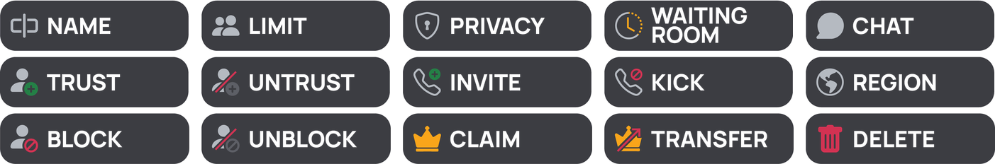

# ANARCHY Voice

Temporary voice channels for Discord. Members join a lobby and instantly get a room of their own, which they manage from a button panel or with chat commands. Empty rooms clean themselves up.



- **Join to create** — joining the lobby creates a room and moves you into it
- **Control panel** — 15 buttons: rename, limit, privacy, region, invite, kick, trust, block, claim, transfer, delete and more
- **Chat commands** — every panel action is also an `av` command typed in the room's own chat
- **Settings follow the owner** — name, limit, privacy, region, trusted and blocked members are remembered and applied to every room they open
- **Up to 3 setups per server** — each with its own lobby, category and panel
- **Customizable panel** — title, description, color, banner and visible buttons per setup
- **Multi-server** — one bot instance serves every server it is in

## Contents

- [Requirements](#requirements)
- [Installation](#installation)
  - [1. Create the Discord bot](#1-create-the-discord-bot)
  - [2. Download and install](#2-download-and-install)
  - [3. Configure](#3-configure)
  - [4. Invite the bot](#4-invite-the-bot)
  - [5. Start the bot](#5-start-the-bot)
  - [6. Set up your server](#6-set-up-your-server)
- [Keeping it running with PM2](#keeping-it-running-with-pm2)
- [Usage](#usage)
- [Configuration reference](#configuration-reference)
- [Updating](#updating)
- [Backups](#backups)
- [Troubleshooting](#troubleshooting)
- [License](#license)

## Requirements

- **Node.js 20 or newer** — check with `node -v`
- **npm** (comes with Node.js)
- **git**
- A Discord account with permission to add bots to your server (**Manage Server**)

`better-sqlite3` ships prebuilt binaries for common systems. If `npm ci` ever has to compile it, you also need build tools: `sudo apt install build-essential python3` on Debian/Ubuntu.

## Installation

### 1. Create the Discord bot

1. Open the [Discord Developer Portal](https://discord.com/developers/applications) and click **New Application**. Give it a name.
2. Open the **Bot** tab:
   - Click **Reset Token**, then copy the token. You will need it in step 3. Treat it like a password.
   - Under **Privileged Gateway Intents**, turn on:
     - **Server Members Intent** — used to find members by name in commands like `avtrust`
     - **Message Content Intent** — used to read `av` commands
   - Click **Save Changes**.
3. Open the **General Information** tab and copy the **Application ID**. You will need it in step 4.

> You do not need to upload any emojis. On first start the bot uploads the 15 panel emojis from `assets/emojis` to your application by itself.

### 2. Download and install

```bash
git clone https://github.com/fw6s/anarchy-voice.git
cd anarchy-voice
npm ci
```

`npm ci` installs the exact dependency versions from `package-lock.json`.

### 3. Configure

Create your `.env` from the example and open it:

```bash
cp .env.example .env
nano .env
```

Paste your bot token after `DISCORD_TOKEN=`:

```env
DISCORD_TOKEN=your-bot-token-here
```

The other values have sensible defaults, see [Configuration reference](#configuration-reference). Lobbies, categories and panels are **not** set in `.env`; you set those in Discord with `/setup`.

Lock the file down so other users on the machine cannot read your token:

```bash
chmod 600 .env
```

### 4. Invite the bot

Open this link in your browser, with `YOUR_APPLICATION_ID` replaced by the Application ID from step 1:

```
https://discord.com/oauth2/authorize?client_id=YOUR_APPLICATION_ID&scope=bot+applications.commands&permissions=322031121
```

Pick your server and click **Authorize**. The link asks only for the permissions the bot uses — no Administrator:

| Permission | Why |
| --- | --- |
| Manage Channels | Create, rename and delete rooms, and create the setup channels |
| Manage Roles | Set room permissions for privacy, trust and block |
| Move Members | Move people into their room, kick them out of it |
| View Channel, Connect, Speak, Stream, Use Voice Activity | Grant these to the room owner (a bot can only grant permissions it has) |
| Send Messages, Embed Links, Attach Files, Read Message History | Post the panel and the room guide |
| Create Invite | `avinvite` |

> The **Add App** button on the bot's profile uses the Developer Portal's default install settings, which by default only install slash commands, not the bot itself. Use the link above, or set **Installation → Default Install Settings** in the Developer Portal to the `bot` and `applications.commands` scopes with the permissions above.

### 5. Start the bot

```bash
npm start
```

A successful start looks like this:

```
[info] logged in as ANARCHY Voice#0000, in 1 server(s)
[info] panel emojis ready: 15/15 (15 uploaded)
[info] slash commands registered
[info] not set up yet: My Server (run /setup there)
```

Slash commands can take a minute to appear in Discord the very first time. To keep the bot online after you close the terminal, see [Keeping it running with PM2](#keeping-it-running-with-pm2).

### 6. Set up your server

In any channel of your server, run:

```
/setup
```

With no options, the bot creates everything for you:

- a **Join to Create** category
- a **🔏JOIN TO CREATE** voice channel — the lobby
- a **🔎┃interface** text channel with the control panel, read-only for members

Join the lobby to test it: you get your own room and a guide message in its chat.

**Using channels you already have**

```
/setup lobby:#join-voice category:#Voice interface:#panel
```

Any option you leave out is created for you.

> **About cleanup.** In a category that `/setup` created, voice channels the bot does not know about are adopted if people are in them and deleted if empty, whenever the bot starts. In a category *you* picked, the bot never touches voice channels that are not its own rooms, so it is safe to point it at a category with permanent channels.

## Keeping it running with PM2

[PM2](https://pm2.keymetrics.io/) restarts the bot if it crashes and starts it again when the machine reboots.

```bash
npm install -g pm2
pm2 start src/index.js --name anarchy-voice
pm2 save
pm2 startup        # run the command it prints to enable start on boot
```

Everyday commands:

```bash
pm2 logs anarchy-voice       # live logs
pm2 restart anarchy-voice    # restart after changing code or .env
pm2 stop anarchy-voice
```

Run only **one** instance per bot token. Two instances would both react to the lobby and create two rooms per join.

## Usage

### Slash commands

Both require the **Manage Server** permission.

| Command | What it does |
| --- | --- |
| `/setup [slot] [lobby] [category] [interface]` | Create or repair a setup. `slot` is 1–3, default 1. Running it again reuses existing channels, recreates deleted ones and refreshes the panel in place. |
| `/config view` | Show all setups on the server and how their panels look |
| `/config panel [slot] [title] [description] [color] [image] [remove_image] [reset]` | Change the panel. With no options it shows the current look. Use `\n` in `description` for a new line. |
| `/config buttons [slot]` | Choose which buttons appear on the panel. Hidden buttons still work as `av` commands. |
| `/config remove slot` | Remove a setup and its panel. Its channels are left in place for you to delete. |

The default banner labels all 15 buttons. If you hide some, upload your own banner with `image`, or use `remove_image`.

### Room commands

Type these in the chat of your room while you are connected to it. A leading `!` or `.` also works, e.g. `!avlimit 5`.

| Command | What it does | Who can use it |
| --- | --- | --- |
| `avname <new room name>` | Rename the room | Owner, trusted |
| `avlimit <0-99>` | Set how many people can join, `0` removes the limit | Owner, trusted |
| `avprivacy <public/private>` | Private: nobody new can join, but the room stays visible | Owner, trusted |
| `avregion <region>` | Pin the room to a voice region, or `auto` | Owner, trusted |
| `avinvite <user>` | DM someone an invite to the room (2 per 10 minutes) | Owner, trusted |
| `avtrust <user>` | Let someone join while private and manage the room | Owner |
| `avuntrust <user>` | Take that trust back | Owner |
| `avblock <user>` | Hide the room from someone and keep them out | Owner |
| `avunblock <user>` | Lift a block | Owner |
| `avkick <user>` | Disconnect someone from the room | Owner |
| `avclaim` | Take over the room when its owner has left | Anyone in the room |
| `avtransfer <user>` | Hand the room to someone else in it | Owner |
| `avdelete` | Delete the room | Owner |

`<user>` can be a mention, a user ID or a username. The panel buttons do the same things; **Waiting Room** and **Chat** are placeholders for now.

**Trusted** members can change the room's settings, but only the owner decides who is trusted or blocked, and only the owner can transfer or delete the room.

Discord allows a channel to be renamed only **twice every 10 minutes**. The bot tells you how long to wait instead of silently hanging.

## Configuration reference

All settings in `.env`:

| Variable | Default | Description |
| --- | --- | --- |
| `DISCORD_TOKEN` | — | Bot token. **Required.** |
| `VC_NAME_TEMPLATE` | `{user}` | Name of a new room. `{user}` = display name, `{tag}` = username |
| `CREATE_COOLDOWN_MS` | `5000` | Minimum time between two rooms from the same person |
| `DB_PATH` | `./data/anarchyvoice.db` | SQLite database. Uploaded panel banners are stored next to it in `panels/`. |

Restart the bot after changing `.env`.

## Updating

```bash
git pull
npm ci
pm2 restart anarchy-voice
```

The database schema upgrades itself on start. Back up `data/` first, just in case.

## Backups

Everything the bot remembers lives in the `data/` folder:

- `anarchyvoice.db` — setups, rooms, and every member's saved settings, trust and block lists
- `panels/` — custom panel banners

The database runs in WAL mode, so copying the file while the bot is running can give a broken copy. Either stop the bot first, or make a safe live copy:

```bash
node -e "require('better-sqlite3')('data/anarchyvoice.db',{readonly:true}).backup('backup.db').then(()=>console.log('done'))"
```

## Troubleshooting

**`Used disallowed intents`**
Turn on **Server Members Intent** and **Message Content Intent** in the Developer Portal (step 1), then start again.

**Slash commands do not show up**
Wait a minute and restart your Discord client. Check that the log says `slash commands registered`, and that the bot was invited with the `applications.commands` scope.

**`/setup` says it is missing permissions**
The bot names the permissions and the channel. Give them to the bot's role — also check that the category you picked does not deny them.

**Joining the lobby does nothing**
Check `/config view` to confirm the lobby is set up, and that the bot has **Manage Channels** and **Move Members** in the category.

**`av` commands are ignored**
Commands only work in the chat of a temporary room, while you are connected to that room. Also check that **Message Content Intent** is enabled.

**Buttons show text instead of icons**
The emoji upload failed; the log shows why. Check that `assets/emojis` is present, then restart.

**`npm ci` fails while building `better-sqlite3`**
Install build tools (`sudo apt install build-essential python3`) and make sure you are on Node.js 20 or newer.

## License

ANARCHY Voice for Discord — Copyright (C) 2026 lowkeyavoidant

Licensed under [Creative Commons Attribution-NonCommercial-ShareAlike 4.0 International](https://creativecommons.org/licenses/by-nc-sa/4.0/). You may share and adapt it for **non-commercial** purposes, as long as you give credit and release your changes under the same license. See [LICENSE](LICENSE) for the full text.
